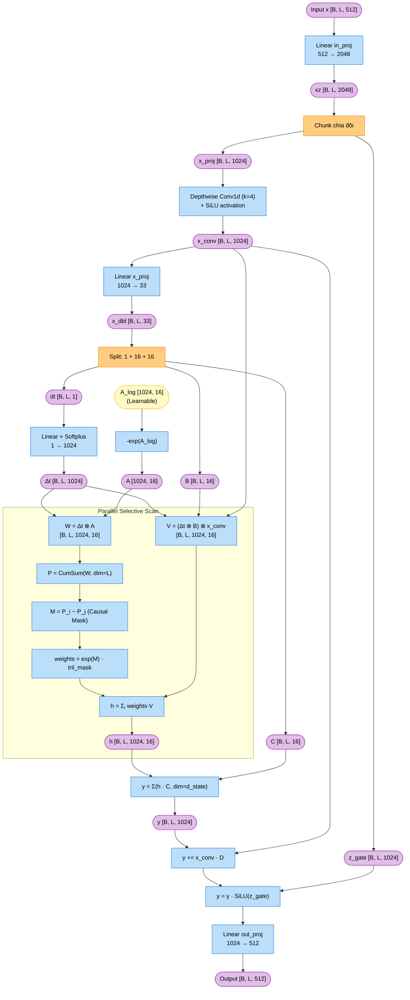
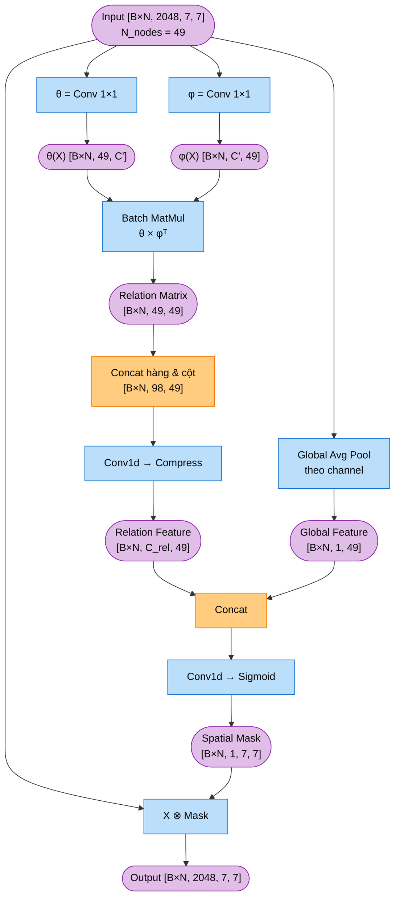
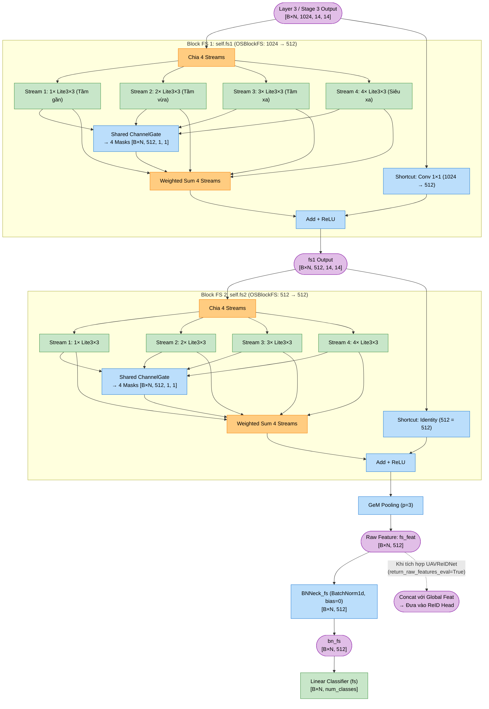
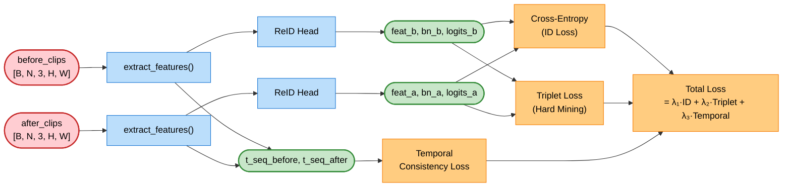

# Kiến Trúc UAVReIDNet — Mermaid Diagrams

## 1. Tổng Quan End-to-End (UAVReIDNet)

```mermaid
flowchart TD
    classDef input fill:#ffcdd2,stroke:#c62828,stroke-width:2px,color:#000
    classDef backbone fill:#e1bee7,stroke:#8e24aa,stroke-width:1px,color:#000
    classDef temporal fill:#bbdefb,stroke:#1976d2,stroke-width:1px,color:#000
    classDef head fill:#c8e6c9,stroke:#388e3c,stroke-width:1px,color:#000
    classDef tensor fill:#fff9c4,stroke:#fbc02d,stroke-width:1px,color:#000
    classDef op fill:#ffcc80,stroke:#f57c00,stroke-width:1px,color:#000
    classDef result fill:#b2dfdb,stroke:#00796b,stroke-width:2px,color:#000

    Input(["📹 Video Clip<br>[B, N, 3, 224, 224]<br>B=batch, N=16 frames"]):::input

    Fold["Fold: gộp B×N<br>[B×N, 3, 224, 224]"]:::op

    subgraph GASNET ["🔬 1. GASNet — Visual Backbone (2D CNN)"]
        direction TB
        Stem["Stem: Conv7×7 → BN → ReLU → MaxPool<br>[B×N, 64, 56, 56]"]:::backbone
        L1["Layer 1 (IBN-a): ResBlock ×3<br>[B×N, 256, 56, 56]"]:::backbone
        L2["Layer 2 (IBN-a): ResBlock ×4<br>[B×N, 512, 28, 28]"]:::backbone
        L3["Layer 3 (IBN-a): ResBlock ×6<br>[B×N, 1024, 14, 14]"]:::backbone
        L4["Layer 4 (BN only): ResBlock ×3<br>[B×N, 2048, 7, 7]"]:::backbone

        RGA_S["RGA Spatial Attention<br>Relation Matrix 49×49"]:::backbone
        RGA_C["RGA Channel Attention<br>Relation Matrix 2048×2048"]:::backbone

        FS["OSBlockFS ×2 (fs1 → fs2)<br>Mỗi block có 4 streams Lite3×3 + Channel Gate<br>[B×N, 512, 14, 14]"]:::backbone

        GeM_G["GeM Pooling (p=3)<br>[B×N, 2048]"]:::backbone
        GeM_FS["GeM Pooling (p=3)<br>[B×N, 512]"]:::backbone

        BNNeck_G["BNNeck_Global (bias=0)<br>[B×N, 2048]"]:::backbone
        BNNeck_FS_bb["BNNeck_FS (bias=0)<br>[B×N, 512]"]:::backbone

        Stem --> L1 --> L2 --> L3
        L3 --> L4
        L4 --> RGA_S --> RGA_C
        L3 --> FS

        RGA_C --> GeM_G --> BNNeck_G
        FS --> GeM_FS --> BNNeck_FS_bb
    end

    ConcatV["Concat (Global + FS)<br>[B×N, 2560]"]:::op
    Reshape["Reshape: view(B, N, -1)<br>[B, N, 2560]"]:::op
    MeanPool_V["Temporal Mean Pooling<br>visual_feat [B, 2560]"]:::op

    subgraph MAMBA ["🧠 2. Temporal Mamba Encoder (SSM)"]
        direction TB
        LinProj["Linear Projection<br>2560 → 512"]:::temporal
        PosEmb["+ Learnable Positional Embedding<br>[B, N, 512]"]:::temporal

        subgraph BiMamba1 ["Bi-Mamba Layer 1 (1 S6 Block gọi 2 lần)"]
            direction TB
            Res1["res = x (lưu residual)"]:::op
            Fwd1["x_fwd = S6Block(x)<br>Chiều xuôi"]:::temporal
            FlipIn1["x.flip → S6Block → .flip<br>x_bwd: Chiều ngược"]:::temporal
            Sum1["x = LayerNorm(x_fwd + x_bwd + res)"]:::op
            Res1 --> Sum1
            Res1 --> Fwd1 & FlipIn1
            Fwd1 & FlipIn1 --> Sum1
        end

        subgraph BiMamba2 ["Bi-Mamba Layer 2 (1 S6 Block gọi 2 lần)"]
            direction TB
            Res2["res = x (lưu residual)"]:::op
            Fwd2["x_fwd = S6Block(x)<br>Chiều xuôi"]:::temporal
            FlipIn2["x.flip → S6Block → .flip<br>x_bwd: Chiều ngược"]:::temporal
            Sum2["x = LayerNorm(x_fwd + x_bwd + res)"]:::op
            Res2 --> Sum2
            Res2 --> Fwd2 & FlipIn2
            Fwd2 & FlipIn2 --> Sum2
        end

        TSeq["temporal_seq [B, N, 512]<br>(cho Temporal Consistency Loss)"]:::temporal
        MeanPool_T["Temporal Mean Pooling<br>[B, 512]"]:::temporal
        MLP["MLP Head: Linear → BN1d → ReLU<br>temporal_token [B, 512]"]:::temporal

        LinProj --> PosEmb
        PosEmb --> BiMamba1
        Sum1 --> BiMamba2
        Sum2 --> TSeq
        Sum2 --> MeanPool_T --> MLP
    end

    subgraph HEAD ["🎯 3. ReID Head"]
        direction TB
        ConcatH["Concat Visual + Temporal<br>[B, 2560 + 512 = 3072]"]:::head
        BNNeck["BNNeck (BatchNorm1d, bias=0)<br>[B, 3072]"]:::head
        Routing{"Train / Eval?"}:::op
        Classifier["Linear Classifier<br>[B, num_IDs]"]:::head
        BN_Feat_Out(["bn_feat [B, 3072]<br>→ Cosine Matching"]):::result

        ConcatH --> BNNeck --> Routing
        Routing -- "Train" --> Classifier
        Routing -- "Eval" --> BN_Feat_Out
    end

    Input --> Fold --> GASNET
    BNNeck_G -.->|"hoặc Raw GeM_G"| ConcatV
    BNNeck_FS_bb -.->|"hoặc Raw GeM_FS"| ConcatV
    ConcatV --> Reshape
    Reshape --> MeanPool_V
    Reshape --> MAMBA

    MeanPool_V --> ConcatH
    MLP --> ConcatH

    Classifier --> TrainOut(["(feat, bn_feat, logits)<br>→ Triplet Loss + ID Loss"]):::result
```

---

## 2. Chi Tiết: SimpleS6 Block (Selective State Space)

---

## 3. Chi Tiết: RGA (Relation-Aware Global Attention)

---

## 4. Chi Tiết: Full Scale Branch (2× OSBlockFS: fs1 → fs2)

---

## 5. Training Flow (Siamese Mode)

---

## 6. Inference Flow

```mermaid
flowchart LR
    classDef input fill:#ffcdd2,stroke:#c62828,stroke-width:2px,color:#000
    classDef proc fill:#bbdefb,stroke:#1976d2,stroke-width:1px,color:#000
    classDef result fill:#c8e6c9,stroke:#388e3c,stroke-width:2px,color:#000

    Clip(["Video Clip<br>[1, N, 3, 224, 224]"]):::input
    Backbone["GASNet Backbone<br>(frozen, eval mode)"]:::proc
    Temporal["Temporal Mamba<br>Encoder"]:::proc
    Head["ReID Head<br>(eval: return bn_feat)"]:::proc
    Feature(["Identity Feature<br>bn_feat [1, 3072]"]):::result
    Match["Cosine Similarity<br>Distance Matrix"]:::proc
    Result(["Re-ID Result<br>Rank-1 / mAP"]):::result

    Clip --> Backbone --> Temporal --> Head --> Feature --> Match --> Result
```

